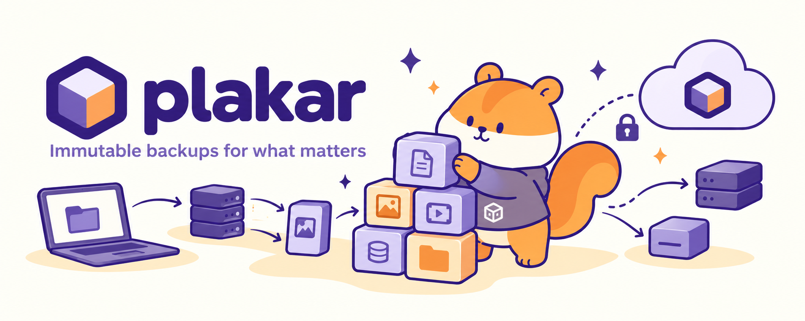

<div align="center">



# Plakar: open source backup engine

**Encrypted, deduplicated, verifiable, and scalable.**

Back up anything, store anywhere, restore everywhere, with zero-trust encryption and no vendor lock-in.

[](https://discord.gg/uuegtnF2Q5)
[](https://www.youtube.com/@PlakarKorp)
[](https://www.reddit.com/r/plakar/)

[Deutsch](https://www.readme-i18n.com/PlakarKorp/plakar?lang=de) |
[Español](https://www.readme-i18n.com/PlakarKorp/plakar?lang=es) |
[français](https://www.readme-i18n.com/PlakarKorp/plakar?lang=fr) |
[日本語](https://www.readme-i18n.com/PlakarKorp/plakar?lang=ja) |
[한국어](https://www.readme-i18n.com/PlakarKorp/plakar?lang=ko) |
[Português](https://www.readme-i18n.com/PlakarKorp/plakar?lang=pt) |
[Русский](https://www.readme-i18n.com/PlakarKorp/plakar?lang=ru) |
[中文](https://www.readme-i18n.com/PlakarKorp/plakar?lang=zh)

</div>

## What is Plakar?

Plakar is an open-source backup solution powered by [Kloset](https://www.plakar.io/posts/2025-04-29/kloset-the-immutable-data-store) and [ptar](https://www.plakar.io/posts/2025-06-27/it-doesnt-make-sense-to-wrap-modern-data-in-a-1979-format-introducing-.ptar/). It creates snapshots of your data, stores them in an encrypted and deduplicated store, and lets you inspect, verify, and restore them later.

Plakar stores backups in a [Kloset](https://www.plakar.io/posts/2025-04-29/kloset-the-immutable-data-store), an open-source, immutable data store that enables the implementation of advanced data protection scenarios.

Through [integrations](https://www.plakar.io/integrations), Plakar can back up and restore databases, Kubernetes workloads, object stores, and other sources alongside regular files.

What sets Plakar apart:

- snapshots are browsable: you can inspect their contents, diff two snapshots, or restore a single file without touching the rest;
- every snapshot is independently verifiable without restoring anything;
- backups are deduplicated and compressed, so keeping many snapshots does not multiply storage costs;
- encryption covers both data and metadata, with an [audited cryptography implementation](https://www.plakar.io/posts/2025-02-28/audit-of-plakar-cryptography/);
- Plakar is extensible through integrations for additional sources, storage backends, and destinations.

Plakar can be used from the command line or through its built-in web UI.

## Quickstart

```sh
# Install (macOS, Linux)
brew install plakar

# Create a local repository
plakar at /var/backups create

# Back up a directory
plakar at /var/backups backup /etc

# List snapshots
plakar at /var/backups ls

# Restore a snapshot
plakar at /var/backups restore -to /tmp/restore <snapshot-id>

# Open the web UI
plakar at /var/backups ui
```

Prebuilt binaries and a Debian/Ubuntu apt repository are also available: see [Installation](https://www.plakar.io/docs/community/v1.1.0/quickstart/installation/). For a full walkthrough, see the [quickstart guide](https://www.plakar.io/docs/community/v1.1.0/quickstart/first-backup).

## Installation

### Homebrew

```sh
brew install plakar
```

### Debian and Ubuntu

Plakar publishes an apt repository. See the [installation guide](https://www.plakar.io/docs/community/v1.1.0/quickstart/installation/) for the setup commands.

### Prebuilt binaries

Download a binary for your platform: https://www.plakar.io/download

### Build from source

Plakar requires Go 1.23.3 or higher.

```sh
go install github.com/PlakarKorp/plakar@latest
```

`@latest` installs the latest release, which includes the web UI. A build of the `main` branch does not: with `go install github.com/PlakarKorp/plakar@main`, or `make` in a clone, `plakar ui` serves the API and a page explaining how to get the UI. To build the UI in a clone, run `make ui` before `make`; it requires Node.js and pnpm.

## More with Plakar

**Archives.** You can export one or more snapshots as a `.ptar` archive using `plakar ptar`. A `.ptar` file is a self-contained, deduplicated, compressed, and encrypted archive.

**Integrations.** Plakar supports additional backup sources and storage backends through its package manager. Available integrations include PostgreSQL, MySQL, etcd, Kubernetes, S3-compatible object stores, and more.

```sh
plakar pkg add <integration>
```

**Distributed stores.** Kloset stores can be synchronized across locations to implement 3-2-1 backup strategies or more advanced push, pull, and sync workflows across heterogeneous environments.

```sh
plakar at /var/backups sync to @s3
```

**Scheduled backups.** Plakar does not run as a daemon. To back up on a schedule, run `plakar backup` from a systemd timer or cron. See [Scheduling backups](https://www.plakar.io/docs/community/v1.1.0/guides/setup-scheduler-daily-backups/).

```sh
0 2 * * * /usr/local/bin/plakar at /var/backups backup /etc
```

**Where restored files land.** `restore -to` writes the contents of the backed-up path directly into the target directory. If the snapshot was taken from `/etc`, `plakar at /var/backups restore -to /tmp/restore <id>` gives `/tmp/restore/hosts`, not `/tmp/restore/etc/hosts`. To restore one directory or file, add its path to the snapshot ID: `<id>:/etc/ssh`.

See the [documentation](https://www.plakar.io/docs/community) for the full list of supported workflows.

## Documentation

https://www.plakar.io/docs/community

- [Quickstart](https://www.plakar.io/docs/community/v1.1.0/quickstart/first-backup)
- [Command reference](https://www.plakar.io/docs/community/v1.1.0/references/commands)
- [Integrations](https://www.plakar.io/integrations)

## Contributing and reporting issues

Please read the [contributing guidelines](./CONTRIBUTING.md) and [code of conduct](./CODE_OF_CONDUCT.md) before opening a pull request.

If you find a bug or want to request a change, open an issue:

https://github.com/PlakarKorp/plakar/issues

## Releasing

Release tags carry the built web UI, `main` does not. Releases are cut from a `release/vX.Y` branch: create it from `main` for a new minor version, and reuse it for its patch releases. To release `vX.Y.Z`:

```sh
git switch release/vX.Y        # for vX.Y.0: git switch -c release/vX.Y main
# set version to "vX.Y.Z" in utils/utils.go
make release-ui
git commit -am "release vX.Y.Z"
git tag vX.Y.Z
git push origin release/vX.Y vX.Y.Z
```

Run `make release-ui` for every release, patch releases included: the branch already carries the previous release's UI, and the release workflow refuses a tag whose UI was not built from its own `ui/web/src`.

## Community

- [Discord](https://discord.gg/A2yvjS6r2C)
- [Reddit](https://www.reddit.com/r/plakar/)
- [YouTube](https://www.youtube.com/@PlakarKorp)

## Changelog

See [CHANGELOG.md](./CHANGELOG.md) for release notes and version history.
